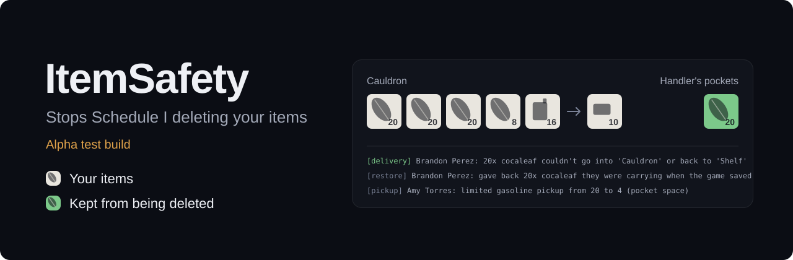

<p align="center">
  
</p>

Your employees and cauldrons stop quietly deleting leaves, petrol and product. Only the host installs it.


<a href="https://github.com/mdoodm/ItemSafety/releases"></a>


**[Download the latest build](https://github.com/mdoodm/ItemSafety/releases)** or read [how to install](#install)

> [!WARNING]
> **ItemSafety is in alpha testing.** It changes how employees and cauldrons move items, and it hasn't had much play time yet.
> - **Back up your saves before you use it.** They're in `%USERPROFILE%\AppData\LocalLow\TVGS\Schedule I\Saves`.
> - Expect bugs. Every fix can be switched off on its own if one causes trouble.
> - Settings, log lines and behaviour may change between alpha builds.

---

## Why use it

You fill a cauldron with 20 leaves and a full can of petrol, sleep, and wake up to an empty cauldron and no product. Or a handler walks off with a stack and it never arrives.

That isn't your imagination. Schedule I 0.4.7 has several places where items are removed from one place before the game checks there's room for them in the next. When the check fails, the items are simply deleted.

ItemSafety catches those moments on the host and keeps the items:

- Employees only pick up what fits in their pockets, and a delivery with nowhere to go stays with them instead of vanishing.
- Items an employee was carrying when the game saved are given back when it loads.
- A cook won't start if its product can't stack with what's already in the output.
- Every change to a cauldron's slots is logged with who made it, so when something does go missing you can see why.

Only the host needs it. Friends can join with an unmodded game, and it works solo too.

## What it fixes

| What you see | Why it happens | What ItemSafety does |
|---|---|---|
| Stock disappears when a handler moves it | The handler takes items from a shelf without checking their pockets have room. Pockets refuse the items, and they're deleted | Picks up only what fits. With full pockets it skips the trip and logs who needs emptying |
| A whole stack vanishes on delivery | The destination filled up on the way (for example you topped up the cauldron yourself) and the source was full too. The game logs `Item will be lost` and deletes it | The employee keeps the items to deliver later |
| Deliveries vanish after you reload or crash | The save remembers what an employee was carrying, but loading never puts it back in their pockets. They fetch a second lot, and the first is gone | Gives the carried items back as the save loads |
| A cook finishes and leaves no cocaine base | The output held a different quality of base, so the new batch couldn't stack and was deleted. The leaves and petrol were already used | Doesn't start that cook. If one finishes anyway, merges the batch at the lower quality |
| Petrol or leaves drop to zero in one go | Not confirmed yet. A joined player's game sends whole slot counts from its own copy, so if their copy is out of date it can overwrite the host's | Logs every cauldron change and flags suspicious drops from joined players. Doesn't block anything yet |

<details>
<summary>Technical details</summary>

- **Pickup:** `MoveItemBehaviour.TakeItem` takes `min(maxMoveAmount, source quantity, destination capacity)` from the source slot, then calls `NPCInventory.InsertItem`, which refuses items that don't fit. ItemSafety also caps the amount by `NPCInventory.GetCapacityForItem`.
- **Delivery:** the `PlaceItem` coroutine falls back to `InsertItemIntoOutput` on the source, and if that fails too it still removes the items from the pocket. ItemSafety measures the pocket, destination and source around each step and puts back whatever arrived nowhere.
- **Reload:** `MoveItemBehaviour.Load` restores the route and `grabbedAmount` but not the pocket contents. Only the active move is saved; NPC pockets aren't saved at all in 0.4.7.
- **Cauldron:** `Cauldron.HasOutputSpace` checks room for a default-quality item instead of the quality the cook will make, and `FinishCookOperation` drops the batch when `OutputSlot.AddItem` refuses it.
- **Joined players:** `ItemSlot.ChangeQuantity` sends `SetItemSlotQuantity(index, localQuantity + change)`, an absolute value, and the host applies it as-is.

</details>

## Install

You need **Schedule I 0.4.7** (the default Steam branch) and **MelonLoader v0.7.3 or later**. Only the host installs it.

1. **Back up your saves.**
2. Install <a href="https://github.com/LavaGang/MelonLoader/releases/latest"><b>MelonLoader v0.7.3</b></a> or later into the game folder.
3. Put `ItemSafety_Il2cpp.dll` in `Schedule I\Mods\`.
4. Launch the game. The log shows `ItemSafety 0.1.0 is an ALPHA test build` when it has loaded.

Check your download against the SHA-256 on the release page:

```
Get-FileHash .\ItemSafety_Il2cpp.dll -Algorithm SHA256
```

### Hosting a big group?

ItemSafety pairs with [BiggerLobbies](https://github.com/mdoodm/BiggerLobbies), which hosts 20 players by default (up to 250) and adds autosave and crash rejoining. They don't overlap, and both are host-only.

## Settings

Everything is on by default. After the first launch you can change it in `UserData\MelonPreferences.cfg`, under `[ItemSafety]`:

| Setting | Default | What it does |
|---|---|---|
| `SafeEmployeePickup` | `true` | Employees only pick up what fits in their pockets |
| `SafeEmployeeDelivery` | `true` | A delivery with nowhere to go stays with the employee |
| `RestoreEmployeeCarry` | `true` | Give employees back what they were carrying when the save loads |
| `CauldronQualityFix` | `true` | Don't start a cook that can't stack with the output; merge instead of deleting |
| `LogCauldronSlots` | `true` | Log every cauldron slot change on the host, with who made it |
| `BackupPlayerLog` | `true` | Keep copies of your last 15 `Player.log` files in `UserData\ItemSafety\Logs` |

## Help test it

This is what the alpha is for. If items still go missing, you can trace exactly what happened.

### What to look for in `MelonLoader\Latest.log`

| Line starts with | Means |
|---|---|
| `[pickup]` | An employee's pickup was limited or skipped because their pockets were full |
| `[delivery]` | A delivery the game would have deleted was kept |
| `[restore]` | Carried items were given back after loading |
| `[cauldron …]` | A cauldron slot changed, a cook started or finished, or a quality mix was blocked or merged |
| `SUSPICIOUS` | A joined player's game dropped a cauldron's petrol by more than one cook uses |

### Reporting a problem

[Open an issue](https://github.com/mdoodm/ItemSafety/issues) and attach:

- the host's `MelonLoader\Latest.log`
- the host's backed-up `Player-*.log` from `UserData\ItemSafety\Logs`
- if a joined player was involved, their `Player.log` from `%USERPROFILE%\AppData\LocalLow\TVGS\Schedule I\`
- roughly when it happened, and which cauldron or employee

### Quick tips while you test

- If an employee seems stuck, talk to them and empty their pockets. The log names them.
- Empty a cauldron's output before starting a cook with a different leaf quality.

## What's been tested

| Feature | Status |
|---|---|
| Builds and loads against game 0.4.7, all 10 patches attach | Yes |
| Restore on reload | Yes, solo: a handler got back 20 leaves, which were then delivered and cooked |
| Cauldron quality fix: blocking a cook that can't stack | Yes, solo: Standard base in the output with Heavenly leaves was blocked; nothing was lost |
| Cauldron quality fix: merging a batch that finished anyway | Not tested in game yet |
| Cauldron slot logging, solo | Yes |
| Cauldron slot logging with a joined player | Not tested yet |
| Safe pickup, safe delivery | Not tested in game yet (hasn't come up in play) |

Not in a release yet: the results above are from the code on `main`. In the `v0.1.0-alpha` download the cauldron quality fix and slot log never run (see the changelog).

## Not done yet

- Employees don't take leftover pocket items back to storage on their own. Talk to them to empty their pockets.
- Joined players' cauldron changes are logged, not corrected. That waits until the logs show what's really happening.
- Pocket items other than the current delivery are still lost on reload, because the game doesn't save them.

## Build from source

You need the .NET SDK (6.0 or later). Run the game once with MelonLoader so it generates `MelonLoader\Il2CppAssemblies`, then:

```
dotnet build ItemSafety.csproj -c Release -p:GamePath="C:\path\to\Schedule I"
```

`GamePath` can also be an r2modman profile folder. The DLL lands in `bin\Release\net6.0\`.

<details>
<summary>Source layout</summary>

| File | What's in it |
|---|---|
| `Core.cs` | Mod entry, settings, log helpers and the Player.log backup |
| `Items.cs` | Item counting and naming who sent a change |
| `EmployeeFixes.cs` | Safe pickup, safe delivery and restore on reload |
| `CauldronFixes.cs` | Cauldron quality fix and slot logging |

</details>

## Credits

By [mdoodm](https://github.com/mdoodm), with AI assistance. Released under the [MIT licence](LICENSE). Not affiliated with TVGS.
